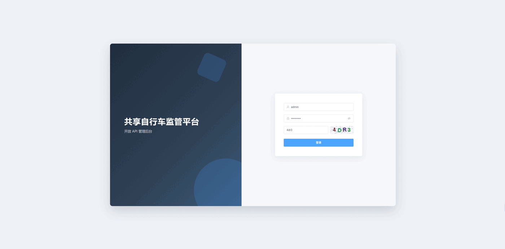
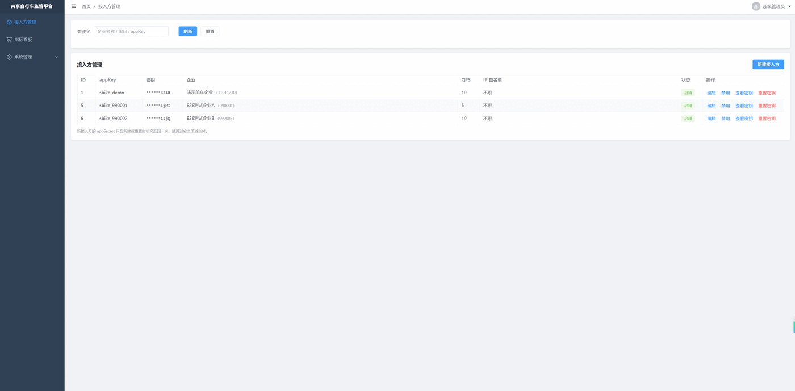
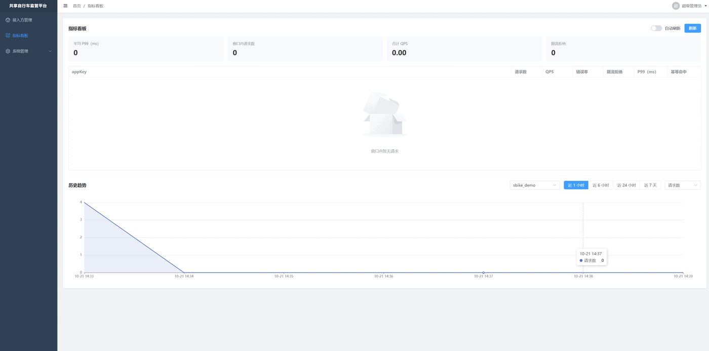

# 共享自行车监管平台开放 API v3

共享自行车监管平台对外开放接口：AppKey 管理与 HMAC 签名、多实例限流、按 appKey 的监控指标、Java SDK。签名由 SDK 拦截器自动完成，厂商无需自行实现。

## 技术栈

| 组件 | 版本 | 用途 |
|---|---|---|
| JDK | 1.8.0_431 | 与服务端编译目标一致，SDK 同样兼容 JDK 8 |
| Spring Boot | 2.7.18 | Web、Actuator、配置 |
| MyBatis-Plus | 3.5.5 | 持久层 |
| MySQL | 8.0.37 | 凭证、围栏、区域、订单、位置 |
| Redis | 6.2.6 | 限流、Nonce、幂等键 |
| Knife4j / springdoc | 4.3.0 / 1.7.0 | 在线接口文档 |
| Micrometer | Boot 内置 | 指标打点与 Prometheus 导出 |
| Spring Security | 5.7 | 管理台认证与接口级权限校验 |
| jjwt | 0.11.5 | JWT 签发与解析 |
| Vue / TypeScript / Element Plus / Vite | 3.5 / 5.6 / 2.8 / 5.4 | 管理后台前端 |
| OpenAPI Generator | 5.4.0 | 生成 Java SDK（5.x 是支持 JDK 8 的最后一条线） |

## 目录结构

```
open-api/
├── server/                  服务端：v3 接口、鉴权链、管理台 API
│   └── src/main/java/com/bike/openapi/
│       ├── api/v3/          fences、areas、orders、positions 四个对外接口
│       ├── admin/           管理台：auth 鉴权包、用户、角色、菜单、接入方、指标
│       ├── security/        验签、Nonce、IP 白名单、鉴权过滤器
│       ├── ratelimit/       Redis 令牌桶（Lua）
│       ├── idempotent/      幂等键
│       ├── metrics/         秒级窗口统计与打点
│       └── service/ mapper/ domain/ dto/ vo/ common/ config/
├── admin-web/               管理后台前端（Vue 3 + TypeScript + Element Plus + Vite）
├── sdk-java/                由 api/openapi.json 生成并内置签名拦截器的 Java SDK
├── api/openapi.json         对外接口的 OpenAPI 3 描述（由服务导出，纳入版本管理）
├── db/schema.sql            建库建表与演示数据（含管理后台 RBAC，幂等可重复执行）
├── scripts/                 dump-openapi / gen-sdk / smoke-test
└── docs/                    原始规范、旧代码与设计文档
```

## 环境要求

- JDK 8，路径默认 `C:\Program Files\jdk`，可用环境变量 `SBK_JDK8_HOME` 覆盖
- Maven 3.9+
- 构建统一走 `scripts\build-server.bat`，它会把 `JAVA_HOME` 固定到 JDK 8。直接敲 `mvn` 会用系统 `JAVA_HOME`，若不巧是 JDK 23+ 就会编译失败（原因见「常见问题」）
- MySQL 8.0（示例用 Docker 容器，root/123456，端口 3306）
- Redis 6.2+（端口 6379，无密码）

## 快速开始

1. 建库建表。脚本幂等（`CREATE TABLE IF NOT EXISTS` + `INSERT IGNORE`），全新环境和已有数据库都执行同一份，重复执行只补缺失的表与数据，不会清空或覆盖既有数据：

```bash
docker exec -i mysql-8.0 mysql -uroot -p123456 --default-character-set=utf8mb4 < db/schema.sql
```

2. 按需修改 `server/src/main/resources/application.yml`：`spring.datasource.*`、`spring.redis.*`、`admin.jwt.secret`、`admin.jwt.expire-hours`、`openapi.security.*`、`openapi.rate-limit.*`。生产环境必须替换 `admin.jwt.secret`。

3. 启动服务端：

```bash
scripts\build-server.bat -pl server -am clean package
java -Dfile.encoding=UTF-8 -jar server/target/server-1.0.0.jar
```

4. 启动管理后台（另开终端）：

```bash
cd admin-web
npm install
npm run dev
```

5. 打开两个入口：

| 入口 | 地址 |
|---|---|
| 管理后台（开发） | http://localhost:5173 |
| 接口文档 | http://localhost:8080/doc.html |

管理后台初始账号 `admin / Admin@123`，**首次登录强制修改密码**。账号、角色、菜单权限均在数据库维护，不再有配置文件账号。密码改成abc123.com了。

生产部署：`cd admin-web && npm run build`，把 `dist/` 交给 Nginx 托管，参考 `admin-web/nginx.conf.example`（`/admin/api/` 反代到 `:8080`）。

演示接入方 `appKey=sbike_demo`、`appSecret=SbikeDemoSecret2026x9f8e7d6c5b4a3210`，可在管理后台重置。

## 接口契约

统一前缀 `/api/v3`，请求与响应均为 JSON（UTF-8）。

| 方法 | 路径 | 说明 |
|---|---|---|
| GET | `/api/v3/fences?pageNo=1&pageSize=100&fenceId=` | 分页拉取围栏 |
| GET | `/api/v3/areas?pageNo=1&pageSize=100&areaId=` | 分页拉取区域 |
| POST | `/api/v3/orders` | 上传订单，必须带 `Idempotency-Key` |
| POST | `/api/v3/positions` | 上传位置，按（appKey, sn, positionTime）幂等 |

所有接口通过 HMAC 签名认证，不使用 token。时间字段统一为 ISO-8601（`2026-10-21T09:00:00`）。

### 请求头与签名

| Header | 说明 |
|---|---|
| `X-App-Key` | 平台分配的接入方标识 |
| `X-Timestamp` | 毫秒时间戳，允许 ±300 秒（也兼容秒级） |
| `X-Nonce` | 每次请求新生成，16~32 位 `[A-Za-z0-9]` |
| `X-Signature` | 待签串的 HMAC-SHA256 后 Base64 |
| `Idempotency-Key` | 仅订单接口，重试必须复用同一个值 |

待签串由六段组成，用单个换行连接：

```
METHOD + LF + PATH + LF + 规范化query + LF + timestamp + LF + nonce + LF + base64(sha256(body))
```

规范化 query 指按参数名排序后的原始 query（不做解码），无参数时为空串；GET 请求 body 哈希取空串的 SHA-256。

### 响应与错误码

```json
{ "code": "0", "message": "success", "data": {}, "traceId": "8f3c2a1b9d7e6543" }
```

| code | HTTP | 含义 |
|---|---|---|
| GW-40001 | 400 | 缺少必要请求头 |
| GW-40002 | 401 | AppKey 无效或已禁用 |
| GW-40003 | 401 | 签名校验失败 |
| GW-40004 | 400 | 时间戳超出允许范围 |
| GW-40005 | 400 | Nonce 重复，疑似重放 |
| GW-40006 | 403 | IP 不在白名单 |
| GW-40007 | 429 | 限流拒绝 |
| GW-40008 | 400 | 写接口缺少 Idempotency-Key |
| GW-50001 | 503 | Redis 不可用（安全机制不降级） |
| BIZ-40001 | 200 | 参数校验失败 |
| BIZ-40901 | 200 | 订单已存在 |

接入层错误返回真实 4xx，业务结果统一 200 + code，便于网关按状态码统计与告警。

## 鉴权链路

`TraceIdFilter` → `ApiAuthFilter`：缓存 body → 查凭证（60 秒本地缓存，空值也缓存）→ IP 白名单 → IP 粗限流 → 时间戳窗口 → 验签 → 写 Nonce（验签通过后才写，防未认证写放大）→ appKey 限流（Redis 令牌桶）→ 幂等键校验。

- 限流、Nonce、幂等键都在 Redis，多实例共享同一配额；Redis 不可用时返回 503，避免安全机制静默失效。
- 订单写入先抢 Redis 幂等键，数据库 `uk(app_key, order_id)` 兜底并发；业务失败释放幂等键，允许重试。

## 管理后台

前后端分离：前端在 `admin-web/`（Vue 3 + TypeScript + Element Plus），后端只提供 `/admin/api/**` 接口。

### 界面截图

登录页：图形验证码 + 账号密码，首次登录强制改密。



接入方管理：按企业名称、编码或 appKey 搜索，支持启停、重置密钥与查看密钥。



指标看板：上半部分是 60 秒窗口的实时快照，下半部分是分钟级历史趋势，可切换近 1 小时到近 7 天，以及请求数、错误率、P99 三种指标。



## Java SDK

```bash
# 1. 服务启动后导出接口描述（servers 取 openapi.doc.server-url）
scripts\dump-openapi.bat

# 2. 生成并打包 SDK
scripts\gen-sdk.bat
```

调用示例：

```java
ApiClient client = SbikeSdk.create(appKey, appSecret, "http://localhost:8080");

// 查询围栏
ApiResultPageResultFenceVo fences = new FenceApi(client).listFences(1L, 100L, null);

// 上传订单：重试时复用同一个 idempotencyKey
OrderCreateRequest order = new OrderCreateRequest()
        .areaCode("110101").sn("BK0001").orderId("SO0001")
        .startTime(LocalDateTime.now()).endTime(LocalDateTime.now().plusMinutes(30))
        .amount(new BigDecimal("1.50"));
new OrderApi(client).createOrder(idempotencyKey, order);
```

签名、时间戳、nonce 全部由 `HmacSigningInterceptor` 完成，厂商只需填 appKey / appSecret / 服务地址；`Idempotency-Key` 由调用方传入，保证重试幂等。

## 对外交付

新厂商接入时交付以下内容。

| 交付物 | 形式 | 来源 |
|---|---|---|
| 《共享自行车接口规范 v3.0》 | 对外发 PDF，内部留 Word 源文件 | `docs/共享自行车接口规范v3.0.docx` |
| 接口描述文件 | `openapi.json` | `api/openapi.json`，用 `scripts\dump-openapi.bat` 从运行中的服务导出 |
| Java SDK | jar + 源码 + 调用示例 | `sdk-java/` |
| 接入凭证 | appKey、appSecret、环境地址、QPS 配额 | 管理后台「接入方管理」创建 |
| 联调自测清单 | 规范第 9.1 节的 12 条用例 | 作为验收依据，双方逐条确认 |

凭证不随规范下发。创建接入方后单独通过安全渠道发送，appSecret 不进文档、不进邮件正文。

交付流程：

1. 厂商提交企业名称、企业编码、统一社会信用代码、联系人、出口 IP 清单
2. 管理后台创建接入方，生成 appKey / appSecret，按需配置 IP 白名单与 QPS
3. 发送凭证与测试环境地址，厂商在测试环境联调
4. 双方按规范第 9.1 节逐条验收，签署接入确认书后切生产

导出 `openapi.json` 时 `servers` 取启动参数 `openapi.doc.server-url`，对外交付前必须指向正式地址，否则厂商导入后拿到的是 `localhost`。

## 测试

```bash
# 服务端单测 + 集成测试（需要 MySQL、Redis 在线）
mvn -pl server test -Dmaven.test.skip=false

# 管理后台类型检查与构建
cd admin-web && npm run typecheck && npm run build

# SDK 冒烟测试（需要服务端已启动）
scripts\smoke-test.bat
```

覆盖点：签名字符串与 query 规范化、篡改签名被拒、Nonce 重放被拒、相同 Idempotency-Key 返回订单已存在、缺 Idempotency-Key 被拒、位置重复上报幂等、指标窗口统计、JWT 签发与过期、验证码一次性、首次登录强制改密、改密后旧 token 失效、登出即时失效、OPERATOR 角色越权被拒与菜单过滤、SDK 四个场景实测。

## 生产差距

| 项 | 当前实现 | 生产建议 |
|---|---|---|
| Spring Boot 2.7 | 已停止维护 | 升级到 3.x + JDK 17/21，改动集中在 javax→jakarta |
| appSecret | 明文入库 | KMS/AES 可逆加密 + 双密钥轮换过渡期 |
| token 存储 | localStorage + Bearer，XSS 可窃取 | 改用 httpOnly Cookie + CSRF token，或 BFF 模式 |
| 审计 | 无操作审计表 | 落 `sys_operation_log`，接日志平台 |
| 账号体系 | 本地账号 | 接公司 SSO / OIDC，保留本地超管应急 |
| 登录防护 | 图形验证码 | 叠加失败锁定、IP 限流、异地登录告警 |
| 密码策略 | 长度 + 字母数字 | 复杂度校验、历史密码禁用、定期改密 |
| 指标 | 内存窗口 + MySQL 分钟快照（保留 7 天），多实例各写各的 | Prometheus 抓取 + Grafana 聚合 |
| 限流 | 应用内 Lua 令牌桶 | 网关粗限流 + 应用细限流两层 |
| 部署 | 手工 npm build + Nginx | CI 构建产物、容器化、灰度发布 |
| 网关 | 无 | 第三方超 10 家或需灰度/WAF 时上 APISIX 独立模式 |

## 常见问题

- 构建报大量「找不到符号 getXxx/setXxx」：当前 shell 的 JDK 不是 8。从 JDK 23 起 javac 默认不再自动运行注解处理器（等价 `-proc:none`），Lombok 因此静默失效，换 Lombok 版本也没用。用 `scripts\build-server.bat` 代替 `mvn` 即可。
- 管理后台接口返回 401：token 已过期、已登出，或账号被停用/密码被重置，重新登录即可；对外接口的 401 是签名问题，看 `code` 与 `traceId`。
- 管理后台登录后侧边栏空白：确认已执行 `db/schema.sql`（脚本幂等，可重复执行），菜单表为空时不会有任何路由。
- 前端 `npm run dev` 接口 404：确认 Vite proxy 指向的后端已在 8080 启动。
- 改了 QPS 不生效：凭证缓存 60 秒，管理台修改后会清空本机缓存，其他实例最迟 60 秒生效。
- 控制台中文乱码：`java -Dfile.encoding=UTF-8` 启动，终端切到 UTF-8 代码页。
